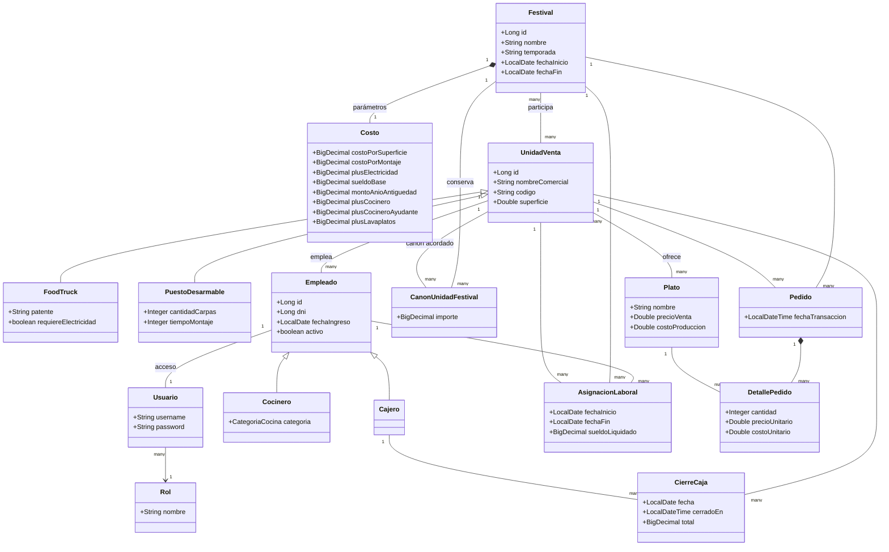

# Modelo de dominio

`AsignacionLaboral` conserva el historial de participación de cada empleado por festival y unidad. El recibo se genera en PDF a partir de esa asignación; no se persiste el archivo.

El canon por unidad y festival conserva el importe de la vinculación. Los detalles de venta y las asignaciones conservan sus propios importes históricos. Al editar un plato compartido o vendido, solo se reemplaza la referencia del menú de la unidad que lo modifica; se conserva el original para las otras unidades y el historial.
